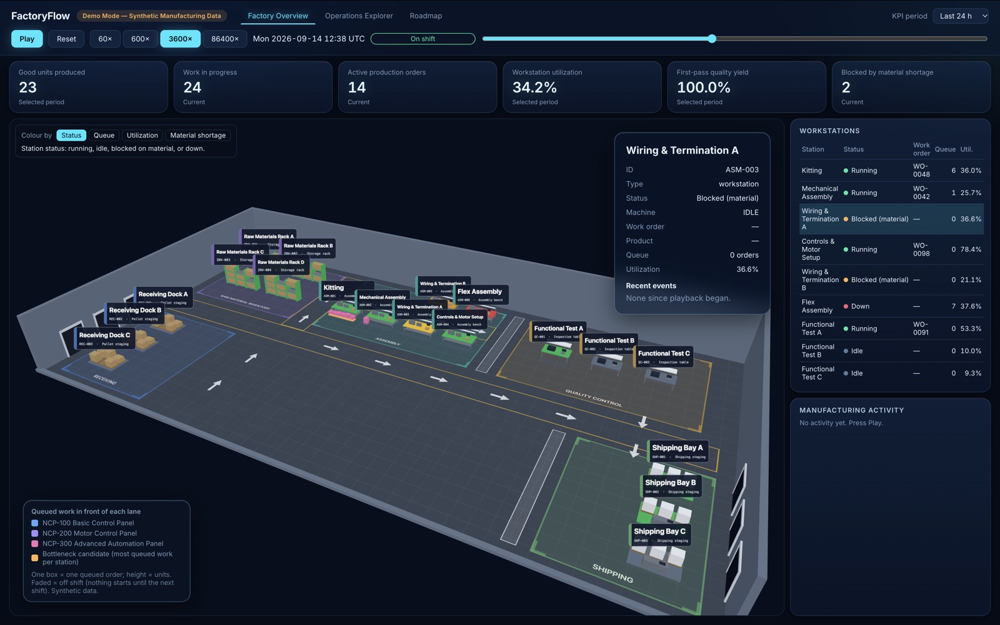

# FactoryFlow

**An open-source manufacturing intelligence application and engineering reference implementation.** It
shows how a manufacturing domain model, event-driven state, operational analytics and an interactive 3D
factory fit together in one understandable, tested codebase.

> **Demo Mode: Synthetic Manufacturing Data.** Everything you see comes from a deterministic simulation of a
> fictional manufacturer. FactoryFlow is an engineering reference implementation. It is **not** a
> production-certified MES, ERP, scheduling or manufacturing-control system, and nothing here has been
> validated against a real plant.

<!-- Confirm the hosted demo is live before publishing this link. -->
**Live demo:** <https://factoryflow.djm-apps.com/> (static, no login, no backend)



## What you can do with it

Play a 30-day synthetic run at up to 86,400x, scrub through it, and investigate what happened. Every
number on screen is computed from the event log and the replayed state, and each one has a written
definition in [`docs/KPI_DEFINITIONS.md`](docs/KPI_DEFINITIONS.md).

- **Factory Overview:** the 3D plant, six dashboard KPIs, a playback toolbar, an activity feed, a
  workstation table and a station inspector. A **Colour by** selector recolours the plant by queue,
  utilization or material shortage, using the same numbers the tables show.
- **Operations Explorer:**
  - **Work Orders:** list and detail drawer with routing, wait/processing/hold per step, an exact
    elapsed-time breakdown, materials, quality history and an event timeline.
  - **Dispatch:** order-to-final-dispatch lead time, on-time in-full dispatch, quantity fill, past-due
    unshipped orders, and a customer-order drawer with allocations, shipments and the work orders planned for it.
  - **Quality:** first-pass yield, rework and scrap rates, defect Pareto and cause, by product and QC station.
  - **Material Shortages:** blocked work orders, the materials they are short of, and the open purchase-order
    supply that could cover each.
  - **Work Centers:** queues, equipment, changeovers, the bottleneck candidate and the conditions around it.
  - **Production Analytics, Bill of Materials and Inventory.**
- **Links between views:** customer order to work order and back, "Show in factory" from the Explorer to the
  3D plant, and shareable URLs such as `#/explorer/orders/WO-0001` or `#/explorer/dispatch/CO-0042`.
- **Dispatch, not delivery:** the model records when goods leave, not when a customer receives them, so
  the metrics are named and labelled on a dispatch basis. The due date is treated as dispatch-by for this
  synthetic manufacturer.

## Quick start

Requires Node.js 22+ and npm.

```bash
git clone https://github.com/djmartin2019/FactoryFlow.git
cd FactoryFlow
npm install
npm run dev          # Vite dev server; open the URL it prints
```

The simulation starts at 3600x (one simulated hour per real second). Nothing else is needed: no database,
no login, no external service. The dataset is committed under `data/generated/` and served from
`public/data/` (a symlink to it).

```bash
npm run build        # typecheck + production build into dist/ (static files)
npm run preview      # serve the production build
npm test             # Vitest suite
```

To regenerate or check the data:

```bash
npm run generate:data                       # default seed "northstar-2026", 30 days
npm run generate:data -- --seed=abc --days=45 --customerOrders=120
npm run validate:data                       # re-validate on disk and prove determinism
```

## What works today, and what is planned

[`docs/STATUS.md`](docs/STATUS.md) is the single source of truth for what exists. In short:

| | |
| --- | --- |
| **Works** | The deterministic simulation and domain model (22 event types, schema 1.3.0), the reducer with its business rules, the dashboard, the Operations Explorer tabs above, the 3D plant with overlays, contract and determinism tests, CI. |
| **Built, not yet used by the app** | The source-integration boundary in `src/sources/`: contracts, canonical JSON, identity, runtime validation, and the simulation expressed as an independent source (wire format, emitter, adapter) with an exact round trip. The app still loads its domain JSON directly. |
| **Planned** | Routing the app through that boundary, deterministic finite-batch ingestion with provenance and quarantine, and an independently authored MES-like second source (release 0.2.0); an optional Databricks reference integration (0.3.0). |
| **Not planned for now** | Unit-level traceability, workforce and scheduling, forecasts, a backend or database, anything commercial. See [`docs/OPEN_SOURCE_DEVELOPMENT_PLAN.md`](docs/OPEN_SOURCE_DEVELOPMENT_PLAN.md), section I. |

What each release does and does not establish:

| Level | Meaning |
| --- | --- |
| Synthetic demonstration (this release, 0.1.0) | An interactive manufacturing-intelligence app on deterministic synthetic data. Says nothing about real systems. |
| Independent-source proof (0.2.0) | The same analytics, UI and 3D run unchanged from a second, independently structured fixture. Still not a real MES or ERP. |
| Databricks reference (0.3.0) | A reproducible example of lakehouse-prepared synthetic data feeding FactoryFlow. Not a production deployment. |
| Production enterprise deployment | **Not provided.** It would need security, reliability, data governance, volume testing and validation against the real plant. |

## How it is built

```
 generator (seeded) ──▶ events.json + initial_state.json        scripts/generate.ts writes data/generated/
                                │  loadSimulationData
                                ▼
 src/manufacturing  ◀── SimulationController  (the ONE simulation clock: speed, play/pause, seek)
 pure TypeScript         FactoryReplay applies events in sequence through one reducer (state.ts)
 no DOM, no Three.js     │
        │                ▼
        │       FactoryState + master data
        │                │ read only
        ├────────────────┼───────────────────────────────┐
        ▼                ▼                               ▼
 src/analytics     src/ui  (vanilla DOM)         src/graphics  (Three.js)
 KPIs, dispatch,   dashboard, Operations         3D plant, overlays, selection;
 quality, queues   Explorer, drawers, routes     reads state and analytics, never writes
```

Four layers with a strict dependency direction (details in [`docs/ARCHITECTURE.md`](docs/ARCHITECTURE.md)):

1. **`src/manufacturing/`** is the domain core: types, the reducer that enforces every business rule, the
   seeded generator and the replay engine. No DOM, no Three.js, no timers.
2. **`src/simulation/`** holds `SimulationController`, the only clock.
3. **`src/analytics/`** is UI-independent reporting over a snapshot of state and events.
4. **`src/ui/` and `src/graphics/`** present it. They read state, analytics and `mapping.ts`; they never mutate state.

### The event-sourced model

The dataset is two files: `initial_state.json` (master data plus opening balances) and `events.json` (an
ordered log of about 4,650 events such as `PURCHASE_ORDER_CREATED`, `OPERATION_STARTED`,
`QUALITY_INSPECTION_COMPLETED`, `SHIPMENT_DISPATCHED`, `MACHINE_FAILED`). `FactoryState` is produced only
by applying events, in sequence, to the initial state, and an invalid transition throws an
`InvariantViolation`. Consequences:

- Anything can be re-derived: seeking or resetting replays the log.
- Inventory is `onHand`, `reserved` and `available`, with `0 <= reserved <= onHand` enforced on every move,
  and WIP is conservation-checked.
- Every event carries the entities it touches, which drives the activity feed, the drawers and 3D highlighting.
- Event shapes and reducer rules are a contract pinned by a committed fixture and hash. Changing them means
  a deliberate fixture update, a schema version bump and a migration note.

The data model and the sources of variability (supplier delays, shortages, machine downtime, quality
failures, a demand surge) are described in [`src/manufacturing/README.md`](src/manufacturing/README.md).

### Where the numbers come from

Each metric is defined before it is displayed: numerator, denominator, window, N/A rules and limitations are
in [`docs/KPI_DEFINITIONS.md`](docs/KPI_DEFINITIONS.md), and [`docs/ARCHITECTURE.md`](docs/ARCHITECTURE.md)
maps each on-screen number to the function and records behind it. The dashboard's six KPIs are good units
produced, work in progress, active production orders, workstation utilization, first-pass quality yield and
orders blocked by material shortage; the Explorer adds the dispatch, quality, shortage, work-center and
inventory measures. Durations are kept exact internally and rounded only for display.

### External data sources

`src/sources/` is the boundary for consuming data other than the simulation: it validates and normalizes
source records, resolves identity, and keeps provenance, without applying business rules. It is built and
tested but not yet wired into the app, so today FactoryFlow runs only on the synthetic simulation. The design
and its milestones are in [`docs/SOURCE_INTEGRATION_PLAN_REV3.md`](docs/SOURCE_INTEGRATION_PLAN_REV3.md).

## The synthetic company and dataset

The fictional **Northstar Components** assembles three control panels, each with its own routing:

| Product | Routing (work centers) |
| --- | --- |
| NCP-100 Basic Control Panel | Kitting, mechanical assembly, wiring and termination, functional test |
| NCP-200 Motor Control Panel | as NCP-100, plus motor-control setup |
| NCP-300 Advanced Automation Panel | as NCP-100, plus controls (PLC/HMI) configuration |

Thirteen raw materials come from five suppliers and ten customers place orders. Defaults: seed
`northstar-2026`, start 2026-09-01, 30 days, 180 customer orders, a demand surge on days 12 to 16, and two
machine failures per assembly station. The plant has 6 assembly stations, 3 inspection cells, 4 raw-material
racks, 3 receiving docks and 3 shipping bays, with sequence-dependent changeovers and shared equipment.

Generation is **deterministic**: the same seed and configuration always produce the same event log, checked
by a hash in `manifest.json`. The generator proposes events through the same reducer the app uses, so
generated data cannot break business rules.

## Project structure

```
src/
  main.ts                    Entry: load data, controller, dashboard, scene, Explorer, URL routes
  manufacturing/             Domain core: types, reducer (state.ts), generator, replay, selectors, mapping
  simulation/                SimulationController (the one clock), data loading, reporting snapshot
  analytics/                 Dispatch, quality, work orders and time, work centers, shortages, inventory, overlays
  sources/                   Integration boundary: contracts, identity, validation, simulation-as-a-source
  data/                      3D layout (factoryLayout.ts)
  graphics/                  Three.js scene, visualizer, interaction
  ui/                        Dashboard, Operations Explorer (ui/explorer), overlay selector, routes
tests/                       Vitest suites, committed fixtures, shared helpers
scripts/                     generate.ts, validate.ts, bench-load.ts
docs/                        See below
deploy/                      Static-hosting notes and scripts
public/                      Static assets; public/data is a symlink to data/generated/
```

| Document | What it is |
| --- | --- |
| [`docs/STATUS.md`](docs/STATUS.md) | What is implemented, partial or proposed today |
| [`docs/ARCHITECTURE.md`](docs/ARCHITECTURE.md) | The data path, layers, IDs, events and where each number comes from |
| [`docs/KPI_DEFINITIONS.md`](docs/KPI_DEFINITIONS.md) | Definition of every metric, with limitations |
| [`docs/OPEN_SOURCE_DEVELOPMENT_PLAN.md`](docs/OPEN_SOURCE_DEVELOPMENT_PLAN.md) | Release scope and roadmap (0.1.0, 0.2.0, 0.3.0) |
| [`docs/SOURCE_INTEGRATION_PLAN_REV3.md`](docs/SOURCE_INTEGRATION_PLAN_REV3.md) | Authoritative design for source independence |
| [`docs/FACTORYFLOW_DESIGN.md`](docs/FACTORYFLOW_DESIGN.md) | Product and domain intent |
| [`docs/PERFORMANCE.md`](docs/PERFORMANCE.md) | Measured baselines (recorded, not asserted in CI) |
| [`docs/REDUCER_RULES.md`](docs/REDUCER_RULES.md) | Every reducer rule, classified |
| [`CLAUDE.md`](CLAUDE.md) | Contributor guidance: layer rules, commands, the contract-change procedure |

## Scripts

| Command | Purpose |
| --- | --- |
| `npm run dev` | Vite dev server |
| `npm run build` | `tsc` and production build into `dist/` |
| `npm run preview` | Serve the production build |
| `npm test` | Vitest suite |
| `npm run typecheck` | Strict typecheck of the domain, scripts, tests and examples |
| `npm run typecheck:app` | Typecheck the app under `src/` |
| `npm run generate:data` | Generate, self-validate and write the dataset |
| `npm run validate:data` | Re-validate the data on disk and confirm determinism |
| `npm run example:replay` | Print dashboard-style views from a replay |

CI (`.github/workflows/ci.yml`) runs the typechecks, the tests, data validation and the build.

## Testing

`npm test` covers the reducer and its invariants (including atomic rejection and differential checks against a
frozen copy of an earlier reducer), generator determinism and data validation, contract tests on a committed
fixture, and every analytics module against independently recomputed sums and hand-built cases. Overlay
highlight sets are checked against the analytics they claim to show, and the URL route parser against
malformed input. The 3D scene itself and the DOM components are verified by hand: there are no automated
browser tests yet.

## Known limitations

- Everything is synthetic. The numbers demonstrate the definitions; they are not operational data.
- Dispatch metrics use dispatch time because the model has no customer-receipt data, and the link from a
  customer order to its work orders is a planning link (finished goods are allocated from stock), not
  traced unit flow.
- Work Centers utilization is N/A when the reporting period contains no scheduled shift time (for example the
  last 24 hours early on a Monday); choose a longer period.
- There is no forecast, capacity plan, workforce or scheduling model, and no unit-level traceability.
- No material-movement animation in 3D yet, and the 3D labels can crowd in the assembly area.
- The scene and Explorer are tuned for desktop widths; narrow screens are lightly tested.
- The production bundle is large (Three.js is loaded eagerly) and the page requests the Inter font from Google Fonts.
- The dataset is a fixed 30-day run; the progress bar ends at the last event.
- Automated UI tests do not exist yet.

## License

Apache License 2.0 is the intended license. The `LICENSE` file will be added once the ownership,
dependency and asset review is complete; until then, treat the repository as all rights reserved.
